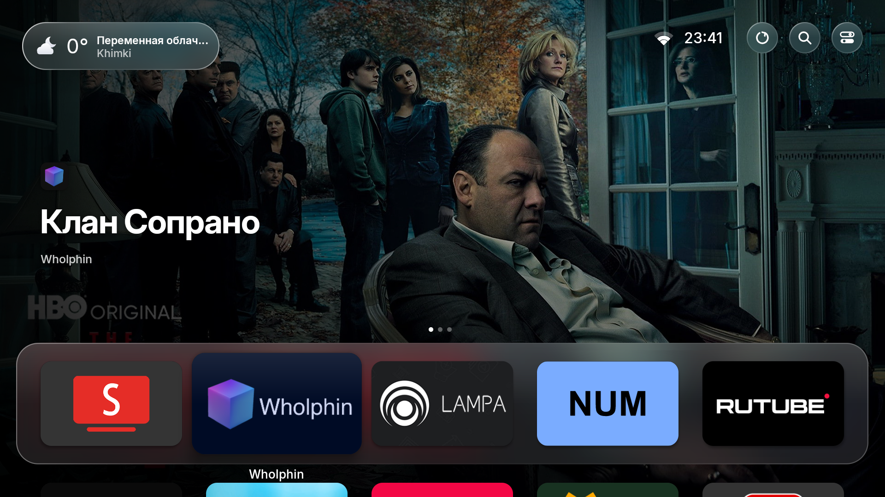
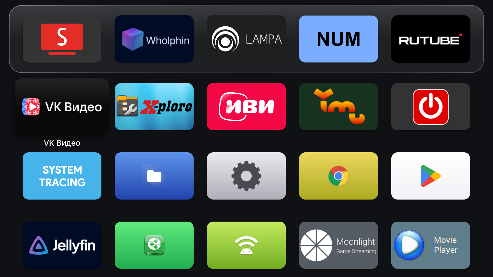
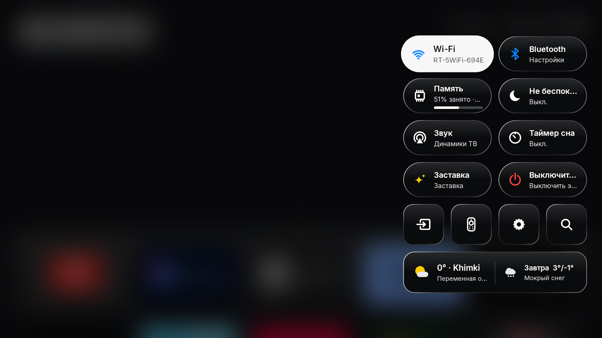

# tvOS Launcher

Лаунчер для Android TV с интерфейсом в стиле Apple TV, управлением с пульта и поддержкой русского и английского языков.



## Возможности

- Стеклянный док и общий список приложений с прокруткой вниз.
- Превью выбранного приложения в первом ряду, если оно публикует соответствующие данные.
- Поиск, погода, профили и панель быстрого управления.
- Заставки с часами и природными сценами.
- Режим презентации: изображения, видео и веб-страницы с управлением из браузера.
- Первоначальная настройка на одном экране.

| Приложения | Панель управления |
|---|---|
|  |  |

[Все скриншоты](docs/screenshots/README.md)

## Установка

1. Скачайте APK из [релизов](https://github.com/Greeg0ry/tvOS-Launcher/releases) и установите его на Android TV.
2. Откройте **tvOS Launcher**, выберите язык и нажмите **Начать**.
3. Выберите лаунчер приложением главного экрана в настройках Android TV.

Установка через ADB:

```sh
adb install -r tvos-home.apk
adb shell am start -n com.techgenius.tvoslauncher/.MainActivity
```

## Сборка

Нужны JDK 17+ и Android SDK с `build-tools;34.0.0` и `platforms;android-34`.

```sh
bash build.sh
```

Для Windows: `powershell -ExecutionPolicy Bypass -File .\build.ps1`. Готовый APK: `build/tvos-home.apk`.

[Документация](docs/README.md) · [Лицензия Apache 2.0](LICENSE)

Основано на [techgenius1/tvOS-Launcher](https://github.com/techgenius1/tvOS-Launcher).
