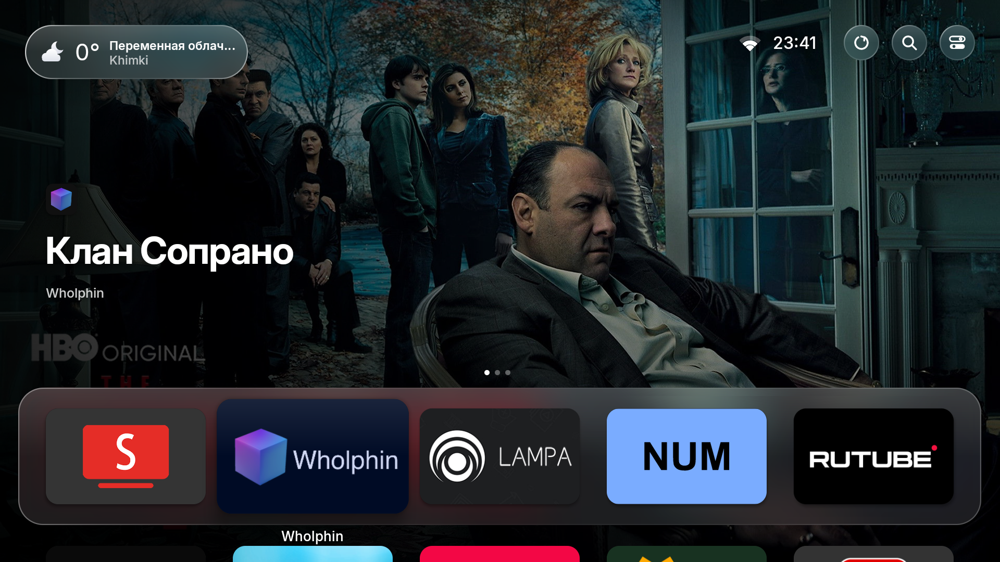

# tvOS Launcher documentation

tvOS Launcher replaces the Android TV Home screen with an Apple TV style app grid,
app-specific previews, glass controls and built-in screen savers.

[Current screenshots](screenshots/README.md) · [Features](features.md)

## Contents

- **[Getting started](getting-started.md)** — install the tools, build, run on a TV or the
  emulator, developer shortcuts, troubleshooting.
- **[Features](features.md)** — everything tvOS Launcher does: setup, Home, carousel, weather, Control
  Center, profiles, inputs, search, screensaver, AirPlay guard, settings, permissions.
- **[Install and set up](install.md)** — make it the home screen, one-time permissions, undo.
- **[Presentation mode](presentation.md)** — sending content from a browser, the TV player,
  start on boot, and the web API.
- **[Architecture](architecture.md)** — code map, build, design decisions and performance notes.
- **[Contributing](../CONTRIBUTING.md)** — workflow, code style, design/performance/permission
  rules, testing and pull requests.

## At a glance

| Area | What it does |
|---|---|
| Dock & grid | Frosted Liquid Glass dock; 5:3 cards, 5 per row; 1.2× focus lift; tvOS zoom-to-open |
| Carousel | Published previews and available recommendations for the selected first-row app; Up opens the full-screen preview |
| Search | Apps, settings, inputs, movies and shows; Russian and English keyboards, dictation; hold Back to open |
| Profiles | Up to 3, unique emoji avatars; separate app layout and history; picker on wake |
| Control Center | Sleep, Wi-Fi, Do Not Disturb, audio, sleep timer, Bluetooth, accessibility, settings, search |
| Presentation | Browser upload of images/videos/webpages, looping full-screen playback, start on boot |
| Settings | A page per section, opened from the gear in Control Center; one-screen initial setup |
