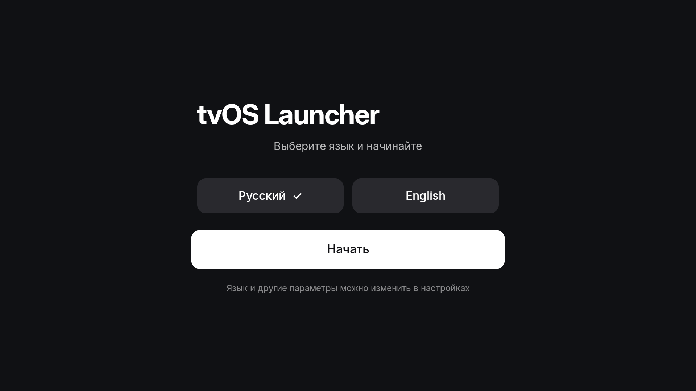
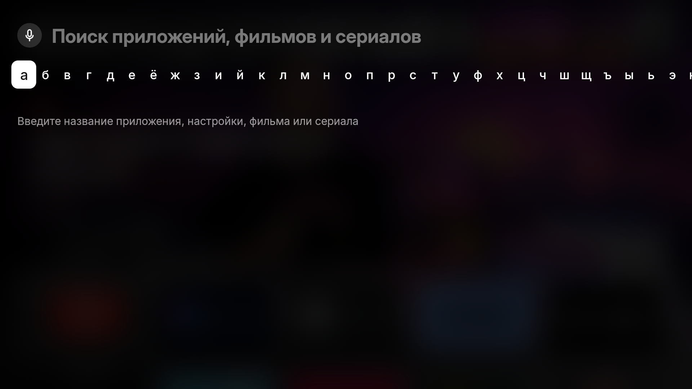
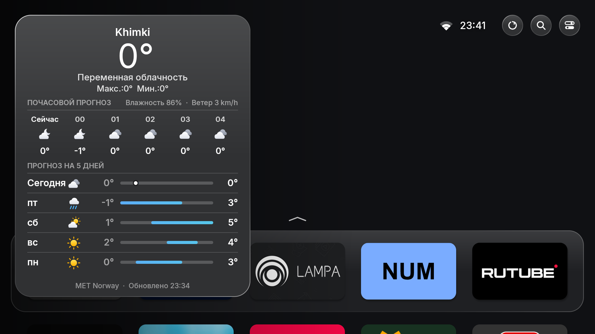
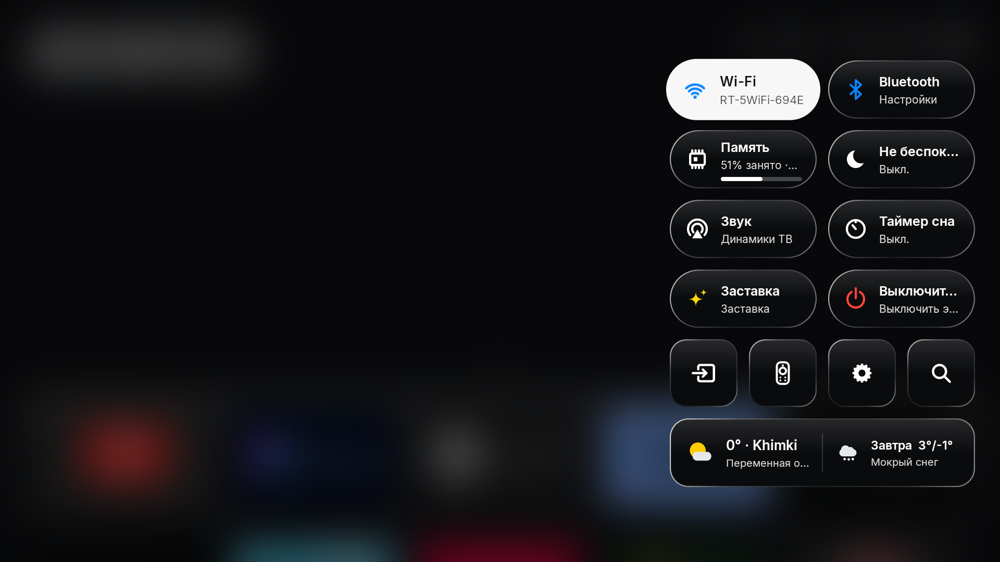
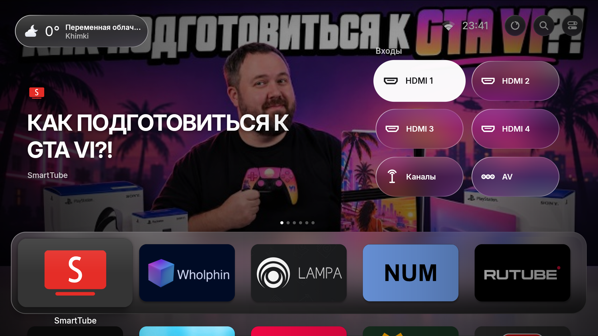

# Features

Everything tvOS Launcher does, by area. For how the code is organised see
[architecture.md](architecture.md); to build it yourself see [getting-started.md](getting-started.md).

- [First-time setup](#first-time-setup)
- [Home screen](#home-screen) · [Remote controls](#remote-controls)
- [Status row](#status-row) · [Search](#search) · [Carousel (top shelf)](#carousel-top-shelf) · [Idle full-screen carousel](#idle-full-screen-carousel)
- [Weather](#weather) · [Control Center](#control-center) · [Profiles](#profiles) · [Inputs](#inputs)
- [Presentation mode](#presentation-mode) · [Screensaver](#screensaver) · [AirPlay](#airplay-with-the-airplay-server-app)
- [Navigation sounds](#navigation-sounds) · [Settings](#settings) · [Permissions](#permissions) · [Display scaling](#display-scaling)

## First-time setup

Choose Russian or English and select **Get Started**. Home opens immediately; profiles, weather,
recommendations and Presentation are optional settings. Permissions are requested when needed by a feature.

## Home screen

- **Default look**: Classic, with a small status clock and five landscape app cards per row,
  matching the Large layout in the Apple TV reference. Down reveals the remaining app rows.
- **Dock**: the first row of apps sits on a frosted Liquid Glass panel (a blurred, colour-boosted
  copy of what is behind it, with lensed edges and a faint rim).
- **Grid**: 5 cards per row in Apple's 5:3 shape; the dock begins at about 69% of the screen
  height, with a glimpse of the next row below. Arrows scroll the grid while preserving the column.
- **Top Shelf**: the focused dock app can show its published Android TV preview programs,
  Continue Watching or recommendations
  as full-screen artwork. Up opens the preview; Back returns to the dock. Apps without available
  content use a neutral background. Continue Watching rows take precedence.
  Presentation and other utility cards keep the app grid visible when Up is pressed; only a ready,
  matching app preview can open full screen.
- **Focus**: the card lifts to 1.2× with a soft shadow and a glare sweep; OK dips the card (the
  HIG's pressed state) and zooms it to full screen while the app opens.
- **Names** appear below the selected card, including a caption outside the dock's glass panel.
- **All apps**: every visible app appears directly in the scrollable grid. Apps previously placed
  in Other Apps are included automatically. Manually hidden apps remain available in Settings.
- **System apps** (Settings, Play Store…) get tvOS-style cards: a gradient with a white glyph.
- **Background**: the selected app's artwork, or a neutral fallback. Home has no wallpapers or wallpaper settings; scenes are used only by screen savers.

### Remote controls

Home shows its shell while the app catalog loads in the background. Scene images and glass
textures are prepared on workers; rapid background changes apply only the latest selection.

| Where | Key | Action |
|---|---|---|
| Any card | OK | Open (zoom animation) |
| Any card | Hold OK / Menu | Options: Open, Move, Hide, App Info, Uninstall, Reset Layout |
| Move mode | Arrows / OK | Move the wiggling card / finish |
| Dock | Up | Carousel |
| Carousel | Left / Right | Previous / next item (wraps around) |
| Carousel (Continue Watching item) | Right | Moves from **Resume** to **Remove** |
| Status row | Left / Right | Weather pill ⇄ Refresh ⇄ Search ⇄ Control Center ⇄ avatar |
| Anywhere on Home | Hold Back for 1 second | Opens Search (a short press of Back works as before) |
| Anywhere on Home | Search key on remotes that have one | Opens Search and starts dictation |
| Anywhere on Home | Keyboard: type a letter or digit · `/` · Ctrl+F · Ctrl+K | Opens Search (with the letter typed) |
| Status row | Down | Carousel (or dock) |
| Anywhere | Home | Closes any overlay and goes to the first app in the dock |
| Idle screen | Any key | Brings the Home Screen back (the press doesn't move focus) |

## Status row

Top right, as on tvOS:

- **Internet indicator and time** use white text and a soft shadow over the artwork. The
  indicator is drawn like Apple's symbols: Wi-Fi bars lit by signal strength (or an Ethernet
  symbol) when the internet works; dimmed bars with **!** on a network that can't reach the
  internet; dimmed bars with a slash when there is no network.
- **Refresh**: fetches a fresh set of recommendations and news, reloads Continue Watching and
  forces a weather update.
- **Search**, **Control Center** and the **profile avatar**.

Glass controls adapt to what is behind them: the backdrop is desaturated and the tint darkens over
bright artwork and lightens over dark artwork, so white text stays legible.

## Search

The magnifier next to Control Center opens Search over the blurred Home Screen, as on tvOS: what
you typed at the top, a one-row keyboard under it, results below. Shortcuts: **hold Back** on any
remote, the Search key on remotes that have one, or just start typing on a keyboard. (The
Assistant/mic button on most Android TV remotes is taken by Google Assistant before any app sees
it, so it can't open tvOS Launcher's Search.)

- **Keyboard**: Russian and English letters, space, delete, **123** (digits and punctuation), an alphabet switch and
  clear. A USB/Bluetooth keyboard and the remote's number keys type too.
- **Dictation**: the **mic** beside the search field (Up from the keyboard), or the remote's
  search/mic button on Home or in Search. Where the TV has Google's voice service, the words appear
  in the field as you speak and results follow; the microphone is asked for on screen the first
  time. Esc on a keyboard, or Back, closes Search. Without that permission or service, the TV's own voice prompt (Google's) listens instead.
  Russian or English according to the interface language, with the other language as an additional recognition language.
- **Before typing**: your recent searches (per profile) and what's trending in the carousel.
- **Apps & Settings** (instant, no internet): installed apps including hidden ones, TV inputs
  ("HDMI 2"), tvOS Launcher screens (Control Center, Weather, Switch Profile, Home Settings) and TV settings
  ("wifi", "bluetooth", "screensaver"…).
- **Movies & TV**: every title on any streaming service in India from JustWatch — Hindi and
  regional titles included, and searches typed in Hindi (पंचायत) work — as posters with the logos
  of the services that have each one. With Stremio or Nuvio installed, **On Stremio** adds titles
  only Stremio's catalogue has. Titles are searched once typing pauses; repeat searches are
  instant.
- **How to Watch**: OK on a poster opens the title's page (artwork, year, genres, IMDb rating,
  summary) with a button per app: **▶ Open in …** for apps you have (straight to the title where
  the app allows it) and **Get …** for the rest (the app's Play Store page), each marked
  *Subscription*, *Free*, *Free with ads*, *Rent* or *Buy*.
- **Any service, no list**: tvOS Launcher matches each service to its app itself — the app named in the
  service's Android TV link, an installed app that opens the service's website, or an installed
  app with the same name — so new services work without an update.
- Settings → Home → Search: turn Movies & TV results off, or clear recent searches. Searches go
  only to JustWatch (and Stremio's catalogue when Stremio/Nuvio is installed); nothing is logged.

## Carousel (top shelf)

Full-screen artwork behind the dock belongs to the focused first-row app. Its carousel can include:

1. **App previews**: artwork and title links the app publishes through Android TV preview channels.
   These work independently of Continue Watching. Availability depends on what the app publishes
   and what the device's TV provider permits the launcher to read. **Open** uses the app's content link.
2. **Continue Watching** (up to six): what you played recently in that app, from the "now playing"
   information apps publish (title, artwork, position, time left). **▶ Resume** opens the app;
   **✕ Remove** drops it. Titles not played again for **7 days** expire.
3. **Recommendations** from the enabled source, filtered to this app's service.

- **Recommendations**: popular titles in India on your services. Source **JustWatch** (no key,
  unofficial API) or **TMDB** (free key). Each refresh picks at random from each service's top 20,
  so the set changes through the day (every 2 hours, or Refresh). **▶ Open** goes to the title's
  page in the app.
- **Stremio** as the source instead: Cinemeta's popular movies and series (no key). **▶ Open**
  goes to the title's page in **Stremio**, or in **[Nuvio](https://github.com/NuvioMedia/NuvioTV)**
  when only Nuvio is installed; **Get** opens Stremio on the Play Store. Settings → Top Shelf →
  Source; with Stremio chosen, *Opens in* shows which app will be used.
- Unavailable or failed artwork leaves the neutral background visible. Rapid focus moves cannot apply
  an older app's result to the selected app.
- Each profile chooses what it shows in Settings → Top Shelf / Continue Watching.

## Idle full-screen carousel

After 20 seconds without input on Home (Settings → Home: Off, 10, 20, 30 or 60 s) the dock and grid
slide down, the weather pill fades, and the carousel keeps playing full screen with its title and
summary at the bottom. The first key press only brings the Home Screen back.
## Weather

- A small glass **weather pill** in the top-left corner: icon, current temperature, condition and
  city, with long text shortened to fit. OK opens the forecast: current conditions, humidity and wind, the next six
  hours, and a 5-day list with temperature range bars (blue → red, a dot for now), as in Apple
  Weather.
- Free sources with no key: [Open-Meteo](https://open-meteo.com) (default),
  [MET Norway](https://api.met.no) and [wttr.in](https://wttr.in); the chosen one first, the others
  as fallbacks. The panel shows which answered and when.
- Updates every **15 minutes** by default (10/15/30/60), and when the internet returns. The last
  forecast is cached, so it shows instantly and offline.
- Location from the internet address (ipapi.co → ipwho.is → geojs.io) unless you choose a city.

## Control Center

Opened from the button next to the time; the whole Home Screen is blurred behind it. The focused
tile turns solid white.

| Tile | What it does |
|---|---|
| Power Off | Puts the TV to sleep (see [Permissions](#permissions)) |
| Memory | Usage bar; OK closes the apps opened from Home since the last clean |
| Wi-Fi | Network name; opens Wi-Fi settings |
| Do Not Disturb | On / off |
| Audio | Current output; opens sound settings |
| Sleep Timer | Off → 15 → 30 → 60 → 90 min |
| Round shortcuts | Inputs (TVs with inputs; Accessibility otherwise), Bluetooth/controllers, Settings, Search |
## Profiles

- Up to **3 profiles**, each with a **unique emoji** on a pastel circle.
- Each keeps its own app layout and hidden apps, carousel choices and Continue Watching.
- The avatar opens a full-screen **Who's Watching?** switcher with large centred avatars over a
  blurred Home Screen and **+ Add User**. Long-press OK (or Menu) on a profile: Rename, Change
  Emoji, Change Colour, Delete.
- With two or more profiles, the switcher can appear when the TV wakes (Settings → Profiles).

## Inputs

Only on TVs with hardware inputs (HDMI, AV, component, tuner): an **Inputs** card starts first in the
dock and an Inputs shortcut sits in Control Center. The picker shows each input with its connector
icon (HDMI, AV, component, S-Video, VGA/DVI, DisplayPort, SCART, USB, antenna); a plugged-in USB
drive appears too. App channel sources (e.g. Mi TV+) are not inputs. The card can be moved, hidden
or switched off (Settings → Inputs).
## Presentation mode

Send images, videos and webpages from any browser on the same Wi-Fi and play them full screen in a
loop, optionally starting with the TV (signage). See **[presentation.md](presentation.md)**.

## Screensaver

tvOS Launcher never holds the screen on, so the TV's own screensaver (e.g. Aerial Views) starts after the
TV's timeout. Settings → Home → **Screensaver on Home**: *System screensaver* (default) or *tvOS Launcher
full-screen carousel*, which keeps the screen on and lets the carousel play instead. Also shows the
TV's screensaver (opens its settings or app) and **Start screensaver now**.

## AirPlay (with the AirPlay Server app)

Android TV can't receive AirPlay by itself. Install the free, open-source
**[AirPlay Server](https://github.com/jqssun/android-airplay-server)** app
(`io.github.jqssun.airplay`, GPL-3.0) and the TV shows up in AirPlay on Macs, iPhones and iPads for
screen mirroring, video and audio. See [install.md](install.md#optional-airplay-receiver) to set it
up. It appears in tvOS Launcher like any other app.

**AirPlay guard** (automatic, only when that app is installed): after long sleeps the AirPlay app
can keep running without announcing itself, so the TV vanishes from AirPlay lists. On wake, when
the network returns and every 15 minutes on Home, tvOS Launcher asks the network (an mDNS query, as a Mac
does) whether the receiver is visible; if not, it restarts the receiver's server through the app's
settings receiver, or starts a stopped app through its start-up receiver. Nothing appears on screen.
The receiver's name is set in the AirPlay app (e.g. "Mi Box").

## Navigation sounds

Android TV's own system sounds: a focus sound per D-pad direction and the key click on select and
Back, at 60% of the normal level. Settings → Home → Navigation sounds.

## Settings

Opened from the gear in Control Center. A main list opens a page per section (Back returns):
Profiles, Top Shelf, Presentation, Inputs, Weather, Continue Watching, Home, Permissions, About, and
the TV's own settings.

## Permissions

tvOS Launcher asks on screen wherever the TV allows it; adb is only a last resort.

| Feature | How it is granted |
|---|---|
| Wi-Fi name (location) | Android's permission prompt |
| Published app previews | Android's TV listings permission prompt after initial setup; independent of Continue Watching |
| Continue Watching & Do Not Disturb | The system notification-access screen. Not possible on low-RAM (1 GB) TVs, where Android disables it — tvOS Launcher says so |
| Power Off & Sleep Timer | Android's "Activate device admin app?" screen; where device admin is switched off (e.g. Mi Box), tvOS Launcher's accessibility switch **tvOS Launcher – Power Off** in the TV's Accessibility settings (opened for you). The same switch lets Clean close apps |
| Search dictation (microphone) | Android's permission prompt the first time the mic is used; without it, the TV's voice prompt is used |
| Home screen | Android 10+ "default home app" prompt, the TV's Home-app settings, or Android's chooser; tvOS Launcher offers this once if another launcher is home |

Only when a TV has none of these screens is the one-time adb command shown.

## Display scaling

All sizes are relative to the screen's resolution (a 960×540 design grid), so the layout keeps its
proportions on 720p, 1080p and 4K and rebuilds itself if the display changes.
