# Скриншоты

Актуальный интерфейс лаунчера на русском языке. Превью первого ряда зависят от данных, опубликованных установленными приложениями.

| Главный экран | Предпросмотр |
|---|---|
| 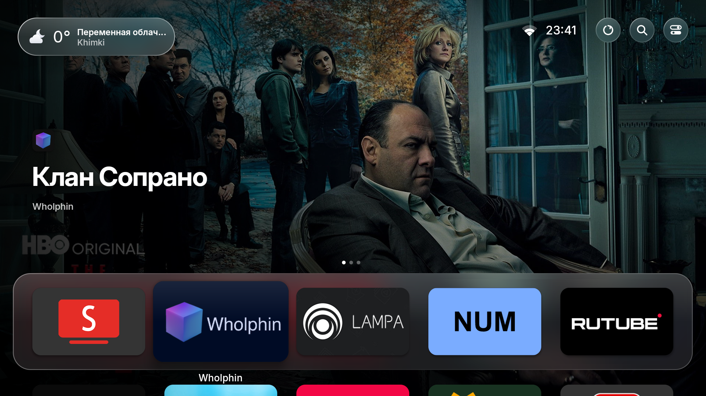 | 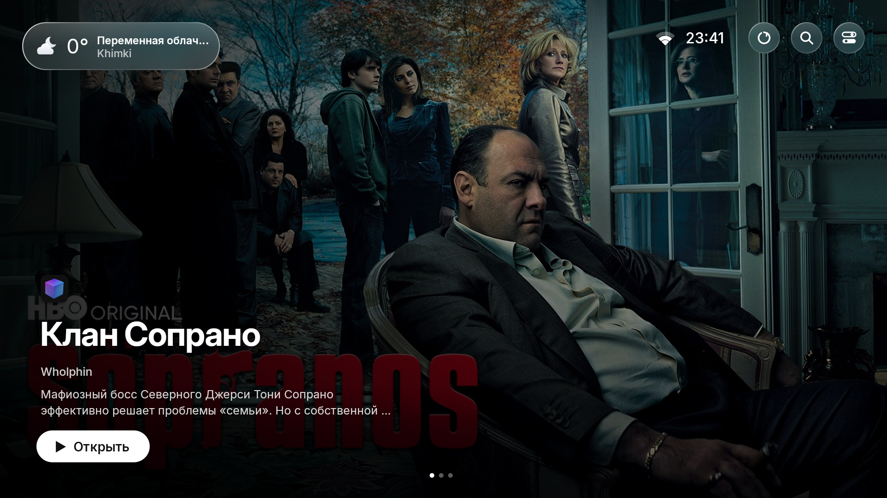 |

| Приложения | Меню приложения |
|---|---|
| 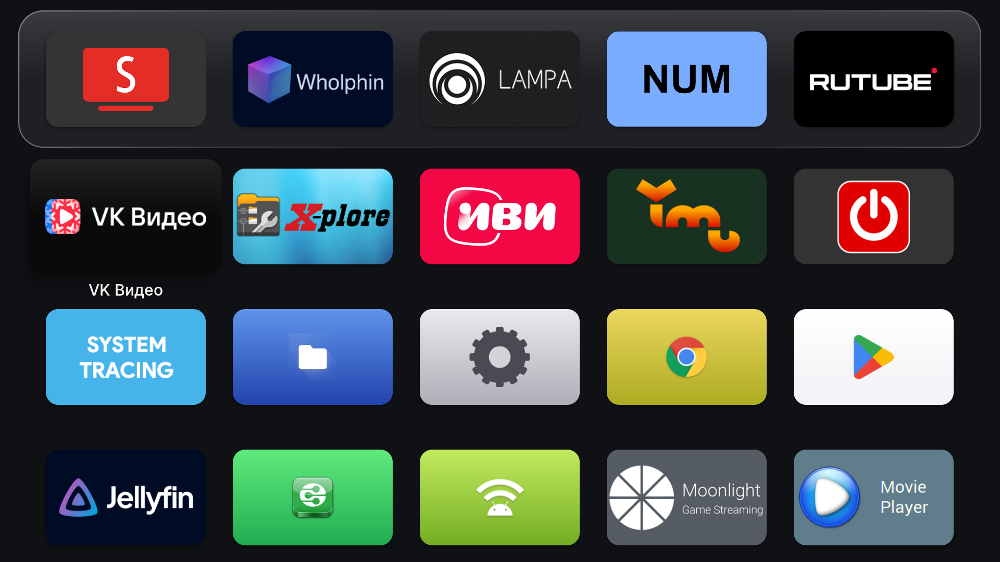 | 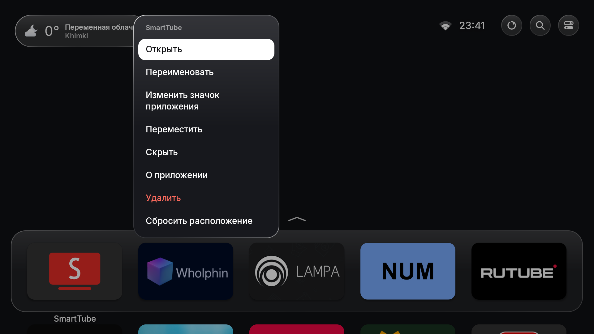 |

| Поиск | Погода |
|---|---|
| 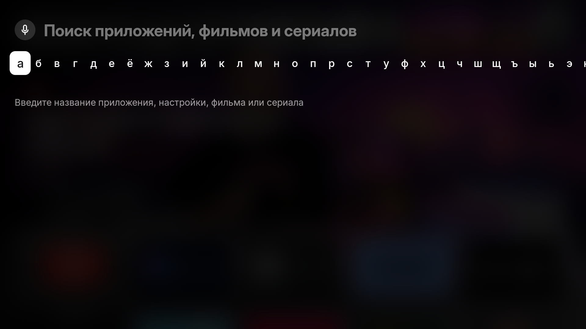 | 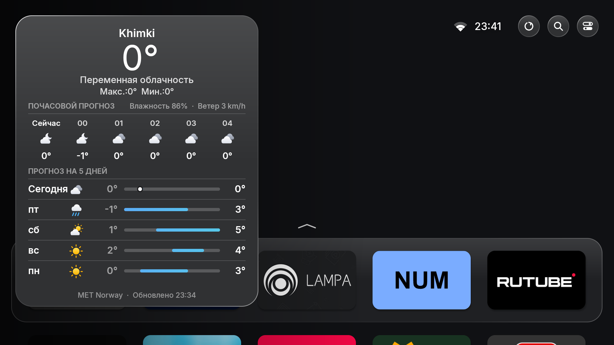 |

| Панель управления | Память и недавние приложения |
|---|---|
| 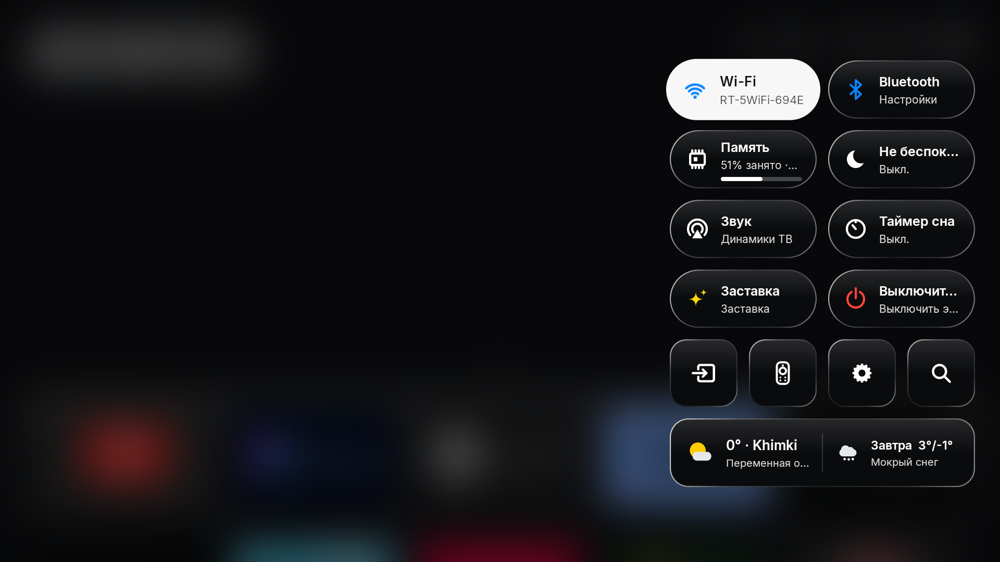 | 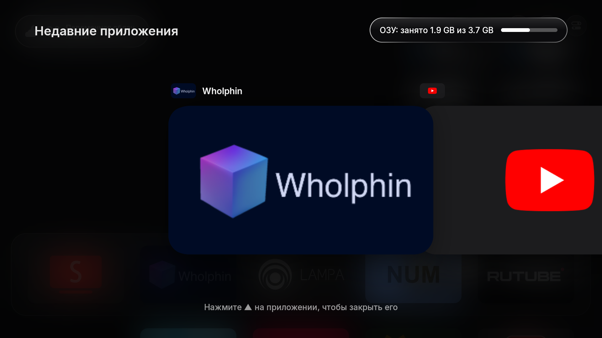 |

| Профили | Входы |
|---|---|
| 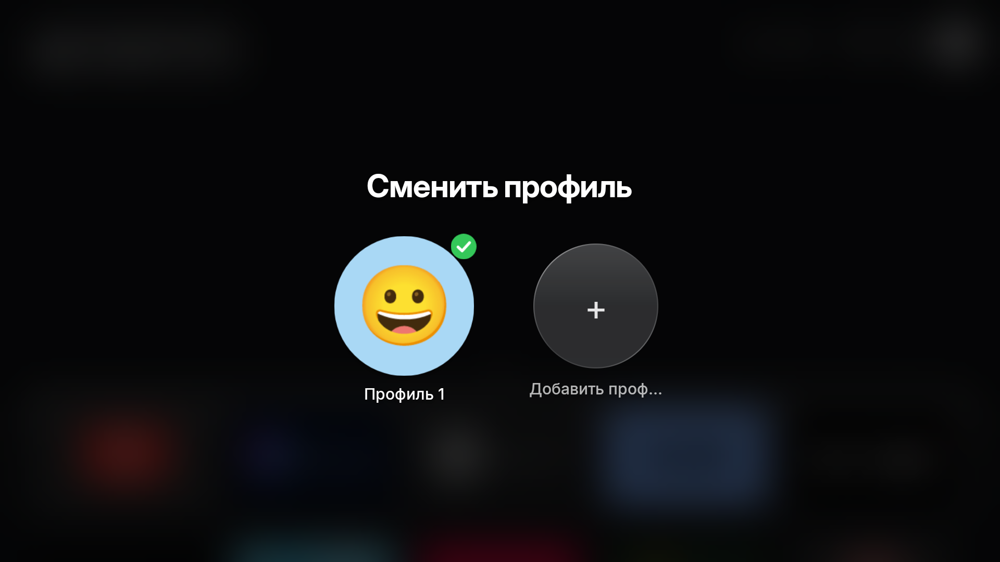 |  |

| Первоначальная настройка | Заставка |
|---|---|
| 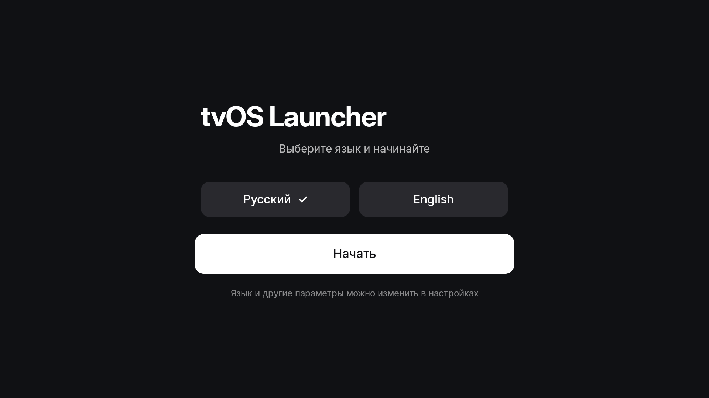 | 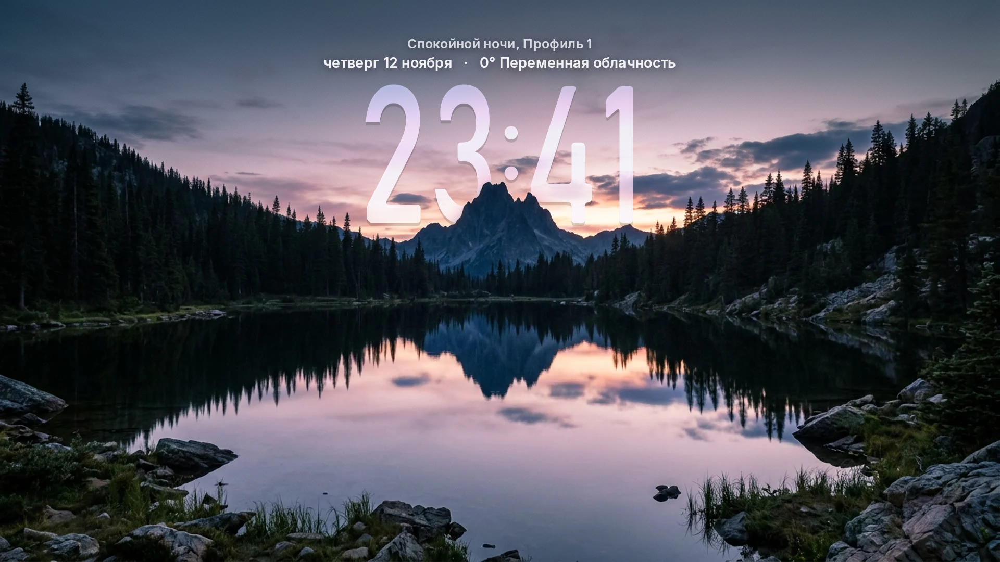 |

| Настройки главного экрана | Настройки приложений |
|---|---|
| 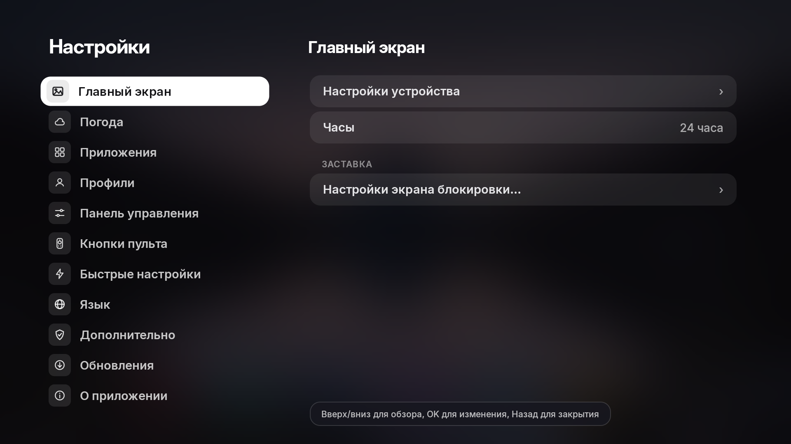 | 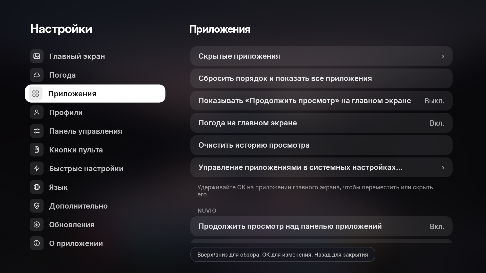 |

| Настройки погоды | Язык |
|---|---|
| 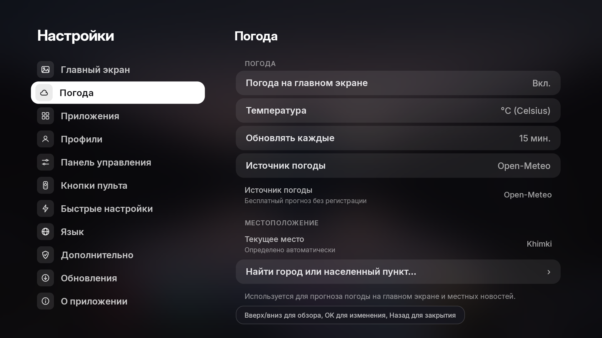 | 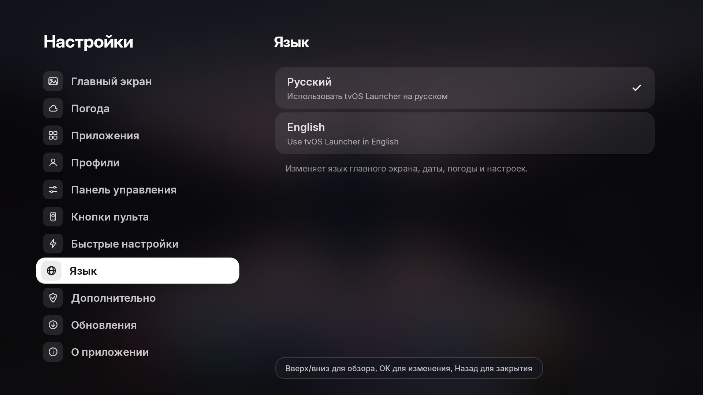 |

| Панель управления | Дополнительные настройки |
|---|---|
| 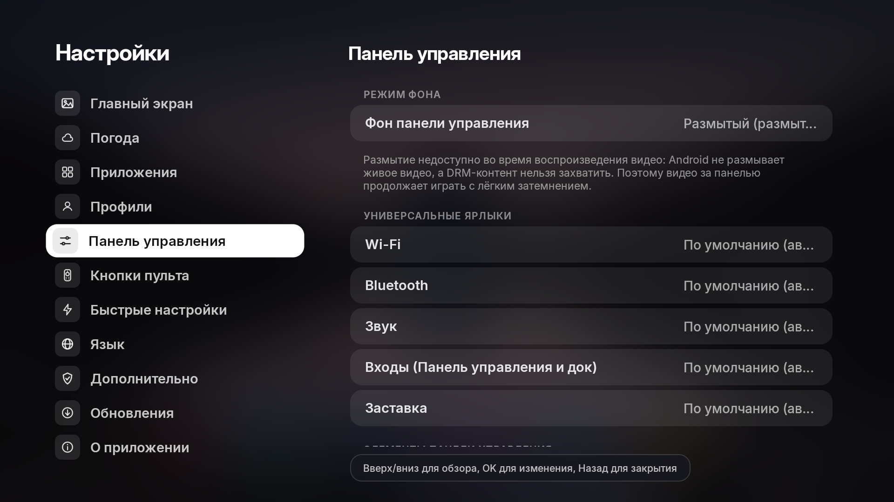 | 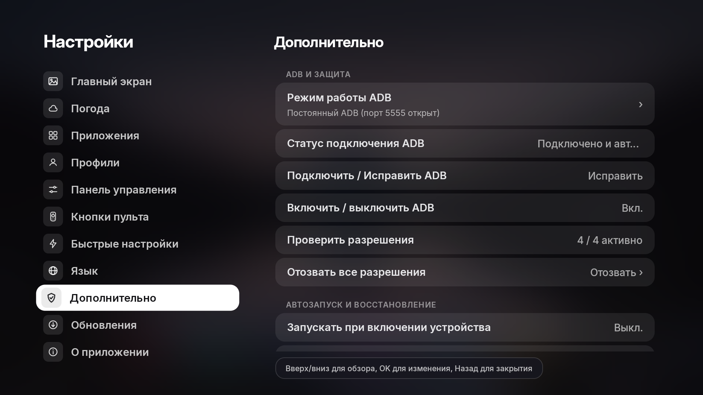 |

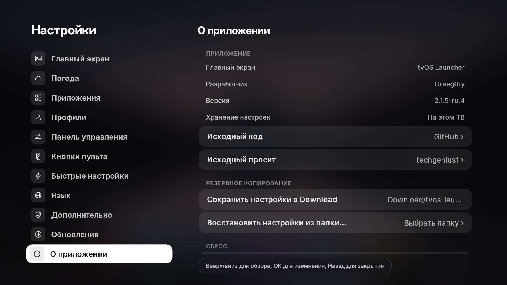
